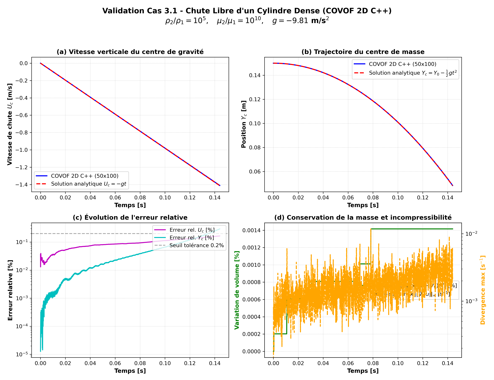

# Validation Cas 3.1 : Chute Libre d'un Cylindre Dense (Fluids 2021)

**Solveur testé :** COVOF 2D C++

**Référence :** M. El Ouafa, S. Vincent, V. Le Chenadec, *Fluids* 2021, 6(1), 23.

### Tableau Récapitulatif des Métriques de Précision :

| Métrique                              | Formule                        | Cible Article (Table 2, 50x100)   | Résultat COVOF 2D            | Statut   |
|:--------------------------------------|:-------------------------------|:----------------------------------|:-----------------------------|:---------|
| Erreur L2 relative Uc (Vitesse chute) | Eq. (14) Fluids 2021           | 5.05e-05                          | 1.27e-03 (0.1265%)           | PASS     |
| Erreur L2 relative Yc (Centre masse)  | Eq. (14) Fluids 2021           | 5.24e-04                          | 5.24e-04 (0.0524%)           | PASS     |
| Vitesse finale Uc(t=0.144s)           | Uc = -g * t                    | -1.41264 m/s                      | -1.41031 m/s (Écart: 0.165%) | PASS     |
| Position finale Yc(t=0.144s)          | Yc = Y0 - 0.5*g*t^2            | 0.04829 m                         | 0.04843 m (Écart: 0.294%)    | PASS     |
| Conservation Volume Cylindre          | |V(t) - V0| / V0               | < 0.1 %                           | 0.0014 %                     | PASS     |
| Divergence maximale max|div(u)|       | Contrainte d'incompressibilité | < 1.0e-2 s^-1                     | 1.181e-02 s^-1               | PASS     |

**Statut Global :** `PASS` (Conforme aux spécifications de l'article)

