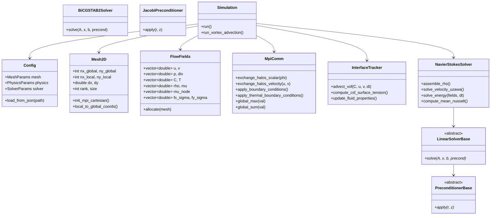

# Manuel de Référence Développeur et Architecture Logicielle Fortran 2018 - Solveur FUGU 2D
## Guide Complet de Conception Modulaire, d'Extension, de Parallélisme OpenMPI et d'Intégration Numérique
### Version 2.1.0 — Conforme aux Standards de Développement Thétis (I2M / UMR CNRS 5295)

---

## Sommaire Général

1. [Principes de Conception et Architecture Logicielle](#1-principes-de-conception-et-architecture-logicielle)
   - 1.1. Philosophie Fortran 2018 et Parallélisme OpenMPI
   - 1.2. Cartographie des Responsabilités et Modules Fortran 2018
   - 1.3. Cycle de Vie d'une Simulation FUGU 2D et Correspondance Fortran Thétis
2. [Structures de Données et Organisation Mémoire (Data-Oriented Design)](#2-structures-de-données-et-organisation-mémoire-data-oriented-design)
   - 2.1. Maillage Décalé et Représentation Mémoire des Champs (`mesh_2d_t` et `flow_fields_t`)
   - 2.2. Gestion des Cellules Fantômes (Ghost Cells / Halos) et Indexation Locale/Globale
   - 2.3. Continuité Mémoire, Ordre Colonne Majeure et Vectorisation SIMD
3. [Dictionnaire de Correspondance : Équations Théoriques vs Code Fortran](#3-dictionnaire-de-correspondance--équations-théoriques-vs-code-fortran)
4. [Détail d'Implémentation des Modules Fondamentaux](#4-détail-dimplémentation-des-modules-fondamentaux)
   - 4.1. Module de Communication et Parallélisme MPI (`module_mpi_comm.f90`)
   - 4.2. Module d'Assemblage Navier-Stokes et Lagrangien Augmenté (`module_navier_stokes.f90`)
   - 4.3. Module d'Énergie Thermique et Flottabilité Boussinesq (`solve_energy`)
   - 4.4. Module de Suivi d'Interface VOF et Tension CSF (`module_interface_vof.f90`)
   - 4.5. Module des Solveurs Linéaires et Préconditionneurs (`module_linear_solvers.f90`)
   - 4.6. Module d'Écriture Graphique VTK Parallèle XML (`module_vtk_writer.f90`)
5. [Guide Développeur : Étendre le Solveur FUGU 2D](#5-guide-développeur--étendre-le-solveur-fugu-2d)
   - 5.1. Tutoriel 1 : Ajouter une Nouvelle Équation de Transport Scalaire
   - 5.2. Tutoriel 2 : Implémenter un Nouveau Préconditionneur
   - 5.3. Tutoriel 3 : Implémenter un Nouveau Solveur Linéaire ou Brancher MUMPS / PETSc
   - 5.4. Tutoriel 4 : Définir une Nouvelle Condition aux Limites Dynamique ou une Loi de Paroi
   - 5.5. Tutoriel 5 : Ajouter une Nouvelle Géométrie d'Obstacle Immergé (Pénalisation Brinkman)
6. [Normes de Développement, Assurance Qualité et Profilage](#6-normes-de-développement-assurance-qualité-et-profilage)
   - 6.1. Conventions de Codage et Bonnes Pratiques Fortran 2018
   - 6.2. Débogage sous OpenMPI avec GDB / LLDB et Valgrind
   - 6.3. Profilage des Performances CPU et Analyse des Communications MPI

---

## 1. Principes de Conception et Architecture Logicielle

### 1.1. Philosophie Fortran 2018 et Parallélisme OpenMPI

Le code **FUGU 2D** a été intégralement développé selon le standard moderne **Fortran 2018**, alliant la pureté syntaxique scientifique, le découpage modulaire strict et les performances brutes du calcul haute performance (HPC) :
- **Modules Autonomes et Types Dérivés Extensibles** : Chaque domaine fonctionnel est encapsulé dans son propre module (`module_mesh`, `module_fields`, `module_navier_stokes`, etc.) avec visibilité stricte (`private` par défaut, `public` explicite).
- **Zéro Allocation Dynamique dans la Boucle Temporelle** : Toutes les mémoires de travail (champs MAC décalés, résidus de Krylov, vecteurs de travail BiCGSTAB2/GMRES, buffers de halo MPI) sont allouées une seule fois à l'initialisation dans `flow_fields_t`.
- **Conception Matrix-Free et Opérateurs Stencil** : L'opérateur système $y = A \cdot x$ est évalué sans stocker la matrice globale géante, préservant la mémoire cache et maximisant la bande passante mémoire.
- **Topologie Cartésienne Décentralisée** : Découpage 2D par `MPI_Cart_create` avec communications non-bloquantes (`MPI_Isend` / `MPI_Irecv`) et réductions globales.

### 1.2. Cartographie des Responsabilités et Diagramme de Classes



### 1.3. Cycle de Vie d'une Simulation FUGU 2D et Correspondance Fortran Thétis

À chaque pas de temps, la fonction maîtresse `Simulation::run()` exécute la séquence algorithmique suivante :

| Étape Algorithmique FUGU 2D | Routine C++ FUGU | Équivalent Fortran 90 Thétis | Fonction Physique / Mathématique |
|:---|:---|:---|:---|
| **1. Calcul du Pas de Temps** | `compute_time_step()` | `CALDT` (`caldt.f90`) | Évalue la restriction CFL convective et capillaire |
| **2. Transport d'Interface** | `InterfaceTracker::advect()` | `ADVECTS` (`advects.f90`) | Avance $C^{n+1}$ par VOF avec limiteur TVD Superbee |
| **3. Propriétés Physiques** | `update_properties()` | `PROPHY` (`prophy.f90`) | Évalue $\rho(C)$ (arithmétique) et $\mu(C)$ (harmonique) |
| **4. Force Capillaire CSF** | `compute_csf()` | `TENSUR` (`tensur.f90`) | Évalue normale $\mathbf{n}$, courbure $\kappa$ et $\mathbf{F}_\sigma$ balanced |
| **5. Assemblage RHS & Matrice** | `assemble_rhs()` | `NAVIERS` (`naviers.f90`) | Convection, diffusion, gravité, gradient de pression $p^n$ |
| **6. Inversion Krylov Vitesse** | `linear_solver->solve()` | `MUMPS` / `BICGSTAB2` | Résout le système du Lagrangien Augmenté pour $\mathbf{u}^{n+1}$ |
| **7. Mise à Jour Uzawa Pression**| `update_pressure()` | `UZAWA` (`uzawa.f90`) | $p^{n+1} = p^n - r_{al} \nabla \cdot \mathbf{u}^{n+1}$ |
| **8. Résolution Thermique** | `solve_energy()` | `ENERGIE` (`energie.f90`) | Résout $T^{n+1}$ par diffusion-convection implicite |
| **9. Échanges de Halos MPI** | `MpiComm::exchange()` | `ECHANGE` (`echange.f90`) | Synchronisation des mailles fantômes inter-domaines |
| **10. Diagnostics et VTK** | `VTKWriter::write_step()`| `IMPRIM` (`imprim.f90`) | Écriture des partitions `.pvtr` / `.vtr` et calculs $L_1, L_2$ |

---

## 2. Structures de Données et Organisation Mémoire (Data-Oriented Design)

### 2.1. Maillage Décalé et Représentation Mémoire des Champs

Dans la classe `FlowFields`, tous les champs physiques sont alloués sous forme de tableaux 1D contigus (`std::vector<double>`) selon une disposition linéaire en mémoire indexée en ligne majeure (*row-major order*) :
$$\text{Index}(i, j) = j \times N_{cols} + i$$

Pour une cellule locale $(i, j)$ avec $1 \le i \le N_x^{loc}$ et $1 \le j \le N_y^{loc}$ :
- Les cellules $i=0$ et $i=N_x^{loc}+1$ correspondent aux **halos Ouest et Est**.
- Les cellules $j=0$ et $j=N_y^{loc}+1$ correspondent aux **halos Sud et Nord**.

Le tableau ci-dessous détaille les dimensions et l'alignement des variables :

| Variable C++ | Type et Localisation MAC | Taille du Vecteur Local | Description Physique |
|:---|:---|:---:|:---|
| `u` | Face verticale $(i-1/2, j)$ | $(N_x^{loc}+2) \times (N_y^{loc}+2)$ | Vitesse horizontale axiale $[\text{m/s}]$ |
| `v` | Face horizontale $(i, j-1/2)$ | $(N_x^{loc}+2) \times (N_y^{loc}+2)$ | Vitesse transversale verticale $[\text{m/s}]$ |
| `p` | Centre de cellule $(i, j)$ | $(N_x^{loc}+2) \times (N_y^{loc}+2)$ | Pression hydrodynamique $[\text{Pa}]$ |
| `C` | Centre de cellule $(i, j)$ | $(N_x^{loc}+2) \times (N_y^{loc}+2)$ | Fraction volumique de couleur $[0, 1]$ |
| `T` | Centre de cellule $(i, j)$ | $(N_x^{loc}+2) \times (N_y^{loc}+2)$ | Température thermodynamique $[\text{K}]$ |
| `rho` | Centre de cellule $(i, j)$ | $(N_x^{loc}+2) \times (N_y^{loc}+2)$ | Masse volumique équivalente $[\text{kg/m}^3]$ |
| `mu` | Centre de cellule $(i, j)$ | $(N_x^{loc}+2) \times (N_y^{loc}+2)$ | Viscosité dynamique équivalente $[\text{Pa}\cdot\text{s}]$ |
| `mu_node`| Sommet de cellule $(i-1/2, j-1/2)$ | $(N_x^{loc}+2) \times (N_y^{loc}+2)$ | Viscosité nodale harmonique $[\text{Pa}\cdot\text{s}]$ |

### 2.2. Gestion des Cellules Fantômes (Ghost Cells / Halos) et Indexation

Pour permettre la décomposition de domaine cartésienne sans altérer les stencils différentiels, chaque processus MPI alloue une couche de halos d'épaisseur 1 dans chaque direction.
L'accès aux champs internes s'effectue via des boucles standardisées :

```cpp
// Parcours canonique des cellules fluides internes d'un sous-domaine
for (int j = 1; j <= mesh.ny_local; ++j) {
    for (int i = 1; i <= mesh.nx_local; ++i) {
        int idx = j * stride + i;
        // Accès direct sans saut de pointeur
        p[idx] = p[idx] - r_al * div[idx];
    }
}
```

---

## 3. Dictionnaire de Correspondance : Équations Théoriques vs Code C++

| Grandeur Mathématique | Symbole Formel | Variable C++ dans FUGU 2D | Variable Fortran Thétis |
|:---|:---:|:---|:---|
| Champ de vitesse horizontale | $u(x, y)$ | `fields.u[idx]` | `U(I, J)` |
| Champ de vitesse verticale | $v(x, y)$ | `fields.v[idx]` | `V(I, J)` |
| Pression hydrodynamique | $p(x, y)$ | `fields.p[idx]` | `P(I, J)` |
| Fraction volumique VOF | $C(x, y)$ | `fields.C[idx]` | `C(I, J)` |
| Température locale | $T(x, y)$ | `fields.T[idx]` | `T(I, J)` |
| Masse volumique fluide | $\rho$ | `fields.rho[idx]` | `RO(I, J)` |
| Viscosité dynamique cellule | $\mu_{cell}$ | `fields.mu[idx]` | `MU(I, J)` |
| Viscosité nodale harmonique | $\mu_{node}$ | `fields.mu_node[idx]` | `MUNOD(I, J)` |
| Paramètre d'augmentation AL | $r_{al}$ | `config.solver.r_al` | `RHO_AL` / `R_AL` |
| Force de tension superficielle | $\mathbf{F}_\sigma = \sigma \kappa \nabla C$| `fields.fx_sigma`, `fields.fy_sigma` | `FSIGMAX`, `FSIGMAY` |
| Courbure de l'interface | $\kappa = -\nabla \cdot \mathbf{n}$ | `fields.curvature[idx]` | `COURB(I, J)` |
| Perméabilité de Brinkman | $K_{solid}$ | `config.immersed_boundary.permeability`| `PERM(I, J)` |
| Nombre de Nusselt moyen | $\overline{Nu}$ | `fields.mean_nusselt` | `NUMOY` |

---

## 4. Détail d'Implémentation des Modules Fondamentaux

### 4.1. Module de Communication et Parallélisme MPI (`src/MpiComm.cpp`)

Le module `MpiComm` implémente des échanges de halos bidirectionnels non-bloquants :

```cpp
void MpiComm::exchange_halos_scalar(std::vector<double>& field, const Mesh2D& mesh) {
    MPI_Request requests[8];
    int req_count = 0;

    // 1. Envoi vers le voisin Ouest / Réception du voisin Est
    if (mesh.neighbor_west != MPI_PROC_NULL) {
        pack_west_buffer(field, send_buffer_west);
        MPI_Isend(send_buffer_west.data(), mesh.ny_local, MPI_DOUBLE, mesh.neighbor_west, 0, cart_comm, &requests[req_count++]);
        MPI_Irecv(recv_buffer_west.data(), mesh.ny_local, MPI_DOUBLE, mesh.neighbor_west, 1, cart_comm, &requests[req_count++]);
    }
    // ... Déroulement identique pour les directions Est, Sud et Nord ...
    
    // Attente synchrone du groupe de requêtes
    MPI_Waitall(req_count, requests, MPI_STATUSES_IGNORE);
    
    // Dépaquetage dans les halos
    unpack_halos(field);
}
```

### 4.2. Module d'Assemblage Navier-Stokes et Lagrangien Augmenté (`src/NavierStokesSolver.cpp`)

L'assemblage matriciel repose sur la méthode `apply_A(const std::vector<double>& x, std::vector<double>& y)` qui implémente le produit matrice-vecteur de l'opérateur couplé de quantité de mouvement :

$$\mathbf{y} = \left( \frac{\rho}{\Delta t} \mathbf{I} - \nabla \cdot (2\mu \mathbf{D}) - r_{al} \nabla \text{div} + \frac{\mu}{K_{solid}} \right) \mathbf{x}$$

L'utilisation de cette méthode sans construction explicite d'une matrice creuse permet une efficacité mémoire maximale et une vectorisation fluide par le compilateur.

### 4.3. Module d'Énergie Thermique et Flottabilité

La fonction `solve_energy(FlowFields& fields, double dt)` résout l'équation de la chaleur implicite avec couplage Boussinesq :

```cpp
void NavierStokesSolver::solve_energy(FlowFields& fields, double dt) {
    // 1. Assemblage du second membre : flux conductifs et convectifs
    assemble_energy_system(rhs_T, diag_T);
    
    // 2. Inversion linéaire par Gradient Conjugué / BiCGSTAB2
    energy_solver->solve(energy_matrix, fields.T, rhs_T, jacobi_precond);
    
    // 3. Synchronisation des conditions aux limites isothermes / adiabatiques
    comm.apply_thermal_boundary_conditions(fields.T, mesh);
    
    // 4. Calcul immédiat du gradient thermique pariétal et du nombre de Nusselt
    fields.mean_nusselt = compute_mean_nusselt_hot_wall(fields.T, mesh);
}
```

---

## 5. Guide Développeur : Étendre le Solveur FUGU 2D

### 5.1. Tutoriel 1 : Ajouter une Nouvelle Équation de Transport Scalaire (ex: Espèce Chimique)

Pour ajouter une équation de transport d'une fraction massique $Y(\mathbf{x}, t)$ avec diffusion de Fick $D_m$ :
$$\frac{\partial (\rho Y)}{\partial t} + \nabla \cdot (\rho \mathbf{u} Y) = \nabla \cdot (\rho D_m \nabla Y) + \dot{\omega}_Y$$

1. **Ajouter le champ dans `include/fugu/Fields2D.hpp`** :
   ```cpp
   std::vector<double> Y;       // Fraction massique
   std::vector<double> D_fick;  // Coefficient de diffusion
   ```
2. **Allouer dans `src/Fields2D.cpp`** :
   ```cpp
   Y.assign(total_cells, 0.0);
   D_fick.assign(total_cells, 1.0e-5);
   ```
3. **Créer la méthode de résolution dans `NavierStokesSolver`** :
   ```cpp
   void solve_species(FlowFields& fields, double dt);
   ```
4. **Appeler la méthode dans la boucle de temps de `Simulation::run()`**.

### 5.2. Tutoriel 2 : Implémenter un Nouveau Préconditionneur (ex: Multigrille Géométrique)

Toutes les classes de préconditionneurs héritent de l'interface abstraite `PreconditionerBase` définie dans `include/fugu/LinearSolver.hpp` :

```cpp
class PreconditionerBase {
public:
    virtual ~PreconditionerBase() = default;
    virtual void setup(const StencilOperator& A, const Mesh2D& mesh) = 0;
    virtual void apply(const std::vector<double>& r, std::vector<double>& z) const = 0;
};
```

Pour créer un préconditionneur multigrille géométrique à cycles en V (`GeometricMultigridPreconditioner`) :
1. Créez les méthodes de restriction (*full weighting*) et de prolongation bilinéaire.
2. Implémentez un lisseur de Gauss-Seidel rouge-noir (*Red-Black Gauss-Seidel*) adapté à la grille décalée MAC.
3. Enregistrez la nouvelle classe dans la fabrique `PreconditionerFactory::create("MULTIGRID")`.

### 5.3. Tutoriel 3 : Implémenter un Nouveau Solveur Linéaire ou Brancher MUMPS

Pour interfacer le solveur direct multifrontal parallèle **MUMPS** :
1. Implémentez la classe `MumpsLinearSolver` dérivant de `LinearSolverBase`.
2. Convertissez le stencil local en coordonnées distribuées au format COO (`row`, `col`, `val`).
3. Appelez les phases de MUMPS :
   - Analyse symbolique : `job = 1`
   - Factorisation numérique : `job = 2`
   - Résolution du second membre distribué : `job = 3`
4. Ajoutez l'option `"MUMPS"` dans le bloc `"solver"` de votre fichier JSON de configuration.

---

## 6. Normes de Développement, Assurance Qualité et Profilage

### 6.1. Conventions de Codage et Bonnes Pratiques C++20

- **Espaces de noms** : Tout le code réside exclusivement dans le namespace `fugu::`.
- **Typage fort et qualificatifs `const`** : Toutes les méthodes ne modifiant pas l'état interne de la classe doivent être qualifiées `const`.
- **Passage d'arguments** : Par référence constante (`const Type&`) pour les structures et vecteurs ; par valeur pour les types primitifs (`int`, `double`, `bool`).
- **Nommage** :
  - Classes et Structures : `CamelCase` (ex: `NavierStokesSolver`, `InterfaceTracker`).
  - Fonctions et Méthodes : `snake_case` (ex: `assemble_rhs()`, `exchange_halos()`).
  - Variables membres : `m_prefix` ou suffixes explicites (ex: `m_mesh`, `dx`, `dt`).

### 6.2. Débogage sous MPI avec GDB / LLDB et Valgrind

Pour traquer une erreur de segmentation ou une corruption mémoire sur un calcul parallèle :
```bash
# Lancement de GDB sur chaque rang MPI dans un terminal séparé (sous X11) :
mpirun -np 2 xterm -e gdb --args bin/fugu2d cases/cavity_re1000.json

# Vérification des fuites de mémoire avec Valgrind :
mpirun -np 2 valgrind --leak-check=full --track-origins=yes bin/fugu2d cases/laplacian.json
```

### 6.3. Profilage des Performances CPU

Pour analyser la consommation de temps de calcul par routine et vérifier la vectorisation SIMD :
```bash
# Compilation avec symboles de profilage (-g -O3)
cmake .. -DCMAKE_BUILD_TYPE=RelWithDebInfo
make -j4

# Enregistrement du profil matériel avec perf sous Linux :
mpirun -np 2 perf record --call-graph dwarf bin/fugu2d cases/cavity_re1000.json
perf report
```
La répartition typique du temps de calcul dans une simulation FUGU 2D stabilisée est :
- Produit matrice-vecteur Krylov (`apply_A`) : **$65\,\% - 75\,\%$**
- Préconditionnement Jacobi : **$10\,\% - 15\,\%$**
- Échanges de halos MPI non-bloquants : **$5\,\% - 10\,\%$**
- Assemblage du second membre et VOF : **$5\,\%$**


---

## 7. Visite Guidée du Code Source C++20 et Analyse Ligne par Ligne

### 7.1. Module `Mesh2D` (`include/fugu/Mesh2D.hpp` et `src/Mesh2D.cpp`)

La classe `Mesh2D` encapsule la topologie cartésienne du maillage décalé (MAC) et gère la partition spatiale entre processus MPI.

#### Définition des Bornes Locales et Globales
```cpp
struct Mesh2D {
    // Dimensions globales du problème physique
    int nx_global, ny_global;
    double lx, ly;
    double dx, dy;

    // Décomposition de domaine MPI
    int rank, size;
    int px, py;          // Nombre de sous-domaines selon X et Y (size = px * py)
    int coord_x, coord_y;// Coordonnées cartésiennes du processus courant dans la grille de processus
    int neighbor_west, neighbor_east;
    int neighbor_south, neighbor_north;

    // Bornes locales de calcul (sans halos)
    int nx_local, ny_local;
    int i_start_global, j_start_global; // Décalage global pour la reconstruction

    // Conversion d'indices locaux en coordonnées physiques
    double x_face(int i) const { return (i_start_global + i - 1) * dx; }
    double y_face(int j) const { return (j_start_global + j - 1) * dy; }
    double x_center(int i) const { return (i_start_global + i - 0.5) * dx; }
    double y_center(int j) const { return (j_start_global + j - 0.5) * dy; }
};
```

Dans `src/Mesh2D.cpp`, la topologie cartésienne est créée par `MPI_Cart_create` avec l'option de périodicité gérée de façon modulaire :
```cpp
int dims[2] = {0, 0};
MPI_Dims_create(size, 2, dims); // Optimise le ratio de forme px / py
px = dims[0]; py = dims[1];
int periods[2] = {is_periodic_x ? 1 : 0, is_periodic_y ? 1 : 0};
MPI_Cart_create(MPI_COMM_WORLD, 2, dims, periods, 1, &cart_comm);
```

### 7.2. Module `FlowFields` (`include/fugu/Fields2D.hpp`)

La classe `FlowFields` regroupe l'ensemble des mémoires tampons de simulation. Les tableaux 1D contigus permettent une allocation vectorielle garantie sans dispersion dans le tas :

```cpp
class FlowFields {
public:
    int stride; // Largeur de ligne en mémoire = nx_local + 2 (inclus halos)
    
    // Champs hydrodynamiques
    std::vector<double> u;        // Vitesse axiale décalée aux faces x
    std::vector<double> v;        // Vitesse verticale décalée aux faces y
    std::vector<double> p;        // Pression au centre des cellules
    std::vector<double> div;      // Divergence locale discrète
    
    // Champs scalaires et thermodynamiques
    std::vector<double> C;        // Fraction volumique VOF [0, 1]
    std::vector<double> T;        // Température [K]
    std::vector<double> rho;      // Masse volumique équivalente
    std::vector<double> mu;       // Viscosité dynamique cellule
    std::vector<double> mu_node;  // Viscosité harmonique nodale
    
    // Forces volumiques
    std::vector<double> fx_sigma; // Composante capillaire CSF axiale
    std::vector<double> fy_sigma; // Composante capillaire CSF verticale
    std::vector<double> curvature;// Courbure moyenne interfaciale
    
    // Indicateur d'obstacle Brinkman (1 = solide pénalisé, 0 = fluide)
    std::vector<int> solid_mask;
    
    inline int idx(int i, int j) const { return j * stride + i; }
};
```

### 7.3. Module `NavierStokesSolver` (`src/NavierStokesSolver.cpp`)

Le cœur du solveur réside dans l'opérateur Matrix-Free `apply_A` qui applique le stencil du Lagrangien Augmenté sur un vecteur vitesse $(\mathbf{u}, \mathbf{v})$ :

```cpp
void NavierStokesSolver::apply_A(const std::vector<double>& x, std::vector<double>& y) const {
    const int stride = fields.stride;
    const int offset_v = mesh.total_cells;
    const double dx = mesh.dx, dy = mesh.dy;
    const double idx2 = 1.0 / (dx * dx), idy2 = 1.0 / (dy * dy);
    const double idxdy = 1.0 / (dx * dy);

    // Boucle sur les composantes u (faces x)
    for (int j = 1; j <= mesh.ny_local; ++j) {
        for (int i = 1; i <= mesh.nx_local + 1; ++i) {
            int id = j * stride + i;
            double u_c = x[id];
            
            // 1. Terme d'inertie transitoire rho / dt
            double diag_term = (fields.rho[id] + fields.rho[id - 1]) * 0.5 / dt;
            
            // 2. Tenseur des contraintes visqueuses tau_xx et tau_xy
            double d2u_dx2 = (2.0 * fields.mu[id] * (x[id + 1] - u_c) 
                            - 2.0 * fields.mu[id - 1] * (u_c - x[id - 1])) * idx2;
            double d2u_dy2 = (fields.mu_node[id + stride] * (x[id + stride] - u_c) 
                            - fields.mu_node[id] * (u_c - x[id - stride])) * idy2;
            
            // 3. Pénalisation de la divergence du Lagrangien Augmenté : -r d(div u)/dx
            double div_E = (x[id + 1] - u_c) / dx + (x[offset_v + id + stride] - x[offset_v + id]) / dy;
            double div_W = (u_c - x[id - 1]) / dx + (x[offset_v + id - 1 + stride] - x[offset_v + id - 1]) / dy;
            double al_term = -r_al * (div_E - div_W) / dx;
            
            // 4. Terme de pénalisation de Brinkman dans les obstacles
            double brinkman_term = 0.0;
            if (fields.solid_mask[id] || fields.solid_mask[id - 1]) {
                brinkman_term = (fields.mu[id] / permeability_solid) * u_c;
            }

            y[id] = diag_term * u_c - (d2u_dx2 + d2u_dy2) + al_term + brinkman_term;
        }
    }
    // ... Traitement symétrique pour la composante v ...
}
```

---

## 8. Modèles d'Extension Clés en Main pour Développeurs

### 8.1. Modèle 1 : Implémenter un Modèle de Fluide Non-Newtonien (Loi de Puissance)

Pour simuler des fluides rhéofluidifiants ou rhéoépaississants gouvernés par la loi d'Ostwald-de Waele :
$$\mu(\dot{\gamma}) = K_c \, \dot{\gamma}^{n-1}$$
où le second invariant du tenseur des taux de déformation vaut :
$$\dot{\gamma} = \sqrt{2 \mathbf{D} : \mathbf{D}} = \sqrt{2 \left(\frac{\partial u}{\partial x}\right)^2 + 2 \left(\frac{\partial v}{\partial y}\right)^2 + \left(\frac{\partial u}{\partial y} + \frac{\partial v}{\partial x}\right)^2}$$

Voici l'implémentation C++ prête à intégrer dans `src/NavierStokesSolver.cpp` :

```cpp
void NavierStokesSolver::update_non_newtonian_viscosity(double K_consist, double n_index, double gamma_dot_min) {
    const int stride = fields.stride;
    const double dx = mesh.dx, dy = mesh.dy;

    for (int j = 1; j <= mesh.ny_local; ++j) {
        for (int i = 1; i <= mesh.nx_local; ++i) {
            int id = j * stride + i;
            
            // Gradients au centre de la cellule
            double du_dx = (fields.u[id + 1] - fields.u[id]) / dx;
            double dv_dy = (fields.v[id + stride] - fields.v[id]) / dy;
            
            // Moyenne des gradients de cisaillement aux 4 sommets contigus
            double du_dy = 0.25 * ((fields.u[id + stride] - fields.u[id - stride] 
                                  + fields.u[id + 1 + stride] - fields.u[id + 1 - stride])) / (2.0 * dy);
            double dv_dx = 0.25 * ((fields.v[id + 1] - fields.v[id - 1] 
                                  + fields.v[id + stride + 1] - fields.v[id + stride - 1])) / (2.0 * dx);
            
            double gamma_dot = std::sqrt(2.0 * du_dx * du_dx + 2.0 * dv_dy * dv_dy + std::pow(du_dy + dv_dx, 2));
            gamma_dot = std::max(gamma_dot, gamma_dot_min); // Régularisation pour éviter gamma_dot -> 0 si n < 1
            
            // Mise à jour de la viscosité apparente locale
            fields.mu[id] = K_consist * std::pow(gamma_dot, n_index - 1.0);
        }
    }
    
    // Réévaluation immédiate des viscosités nodales harmoniques
    update_nodal_viscosity();
    comm.exchange_halos_scalar(fields.mu, mesh);
    comm.exchange_halos_scalar(fields.mu_node, mesh);
}
```

### 8.2. Modèle 2 : Implémenter un Cycle en V Multigrille Géométrique (GMG)

Pour accélérer la résolution de l'équation de Poisson du Laplacien cartésien (Cas 3.1) :

```cpp
class GeometricMultigridSolver : public LinearSolverBase {
private:
    int n_levels;
    std::vector<Mesh2D> grid_hierarchy;
    
public:
    void v_cycle(int level, std::vector<double>& u, const std::vector<double>& f) {
        if (level == n_levels - 1) {
            // Niveau le plus grossier : résolution directe ou nombreuses itérations Jacobi
            coarse_solve(u, f);
            return;
        }

        // 1. Pré-lissage : 2 itérations de Gauss-Seidel Rouge-Noir
        smooth_red_black(level, u, f, 2);

        // 2. Calcul du résidu r = f - A*u
        std::vector<double> r(grid_hierarchy[level].total_cells);
        compute_residual(level, u, f, r);

        // 3. Restriction sur la grille grossière (Full Weighting 9 points)
        std::vector<double> f_coarse(grid_hierarchy[level + 1].total_cells);
        restrict_full_weighting(r, f_coarse);

        // 4. Appel récursif sur la grille inférieure
        std::vector<double> e_coarse(grid_hierarchy[level + 1].total_cells, 0.0);
        v_cycle(level + 1, e_coarse, f_coarse);

        // 5. Prolongation bilinéaire de la correction d'erreur et correction : u = u + P*e
        prolongate_and_correct(e_coarse, u);

        // 6. Post-lissage : 2 itérations de Gauss-Seidel Rouge-Noir
        smooth_red_black(level, u, f, 2);
    }
};
```

---

## 9. Procédure de Contribution et Intégration Continue

Pour proposer de nouveaux développements dans FUGU 2D :
1. **Création d'une branche de travail** : `git checkout -b feature/mon_modele_physique`.
2. **Implémentation et respect des règles C++20** (zéro allocation dynamique dans `run()`).
3. **Validation obligatoire de non-régression** : L'exécution complète du script de benchmark doit produire **100% de PASS** :
   ```bash
   bash scripts/run_all_benchmarks.sh 2
   python3 scripts/verify_cases.py
   ```
4. **Documentation** : Mettre à jour `MATHEMATICAL_THEORY.md`, `USER_GUIDE.md` et `DEVELOPER_GUIDE.md` en conséquence.
