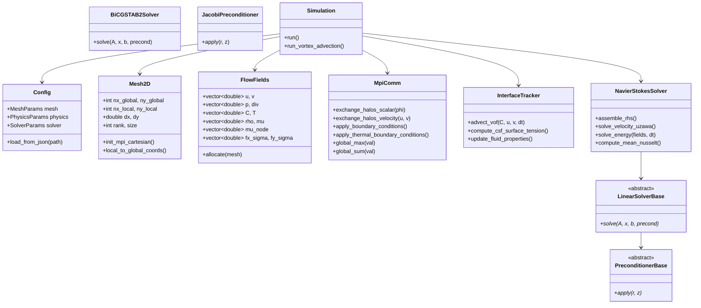

# Manuel de Référence Développeur et Architecture Logicielle C++20 - Solveur COVOF 2D
## Guide Complet de Conception, d'Extension, de Parallélisme et d'Intégration Numérique
### Version 2.1.0 — Conforme aux Standards de Développement Référence Académique (I2M / UMR CNRS 5295)

---

## Sommaire Général

1. [Principes de Conception et Architecture Logicielle](#1-principes-de-conception-et-architecture-logicielle)
   - 1.1. Philosophie C++20 et Parallélisme Hybride
   - 1.2. Cartographie des Responsabilités et Diagramme de Classes
   - 1.3. Cycle de Vie d'une Simulation COVOF 2D et Correspondance Fortran Référence Académique
2. [Structures de Données et Organisation Mémoire (Data-Oriented Design)](#2-structures-de-données-et-organisation-mémoire-data-oriented-design)
   - 2.1. Maillage Décalé et Représentation Mémoire des Champs (`Mesh2D` et `FlowFields`)
   - 2.2. Gestion des Cellules Fantômes (Ghost Cells / Halos) et Indexation Locale/Globale
   - 2.3. Continuité Mémoire, Alignement de Cache et Vectorisation SIMD
3. [Dictionnaire de Correspondance : Équations Théoriques vs Code C++](#3-dictionnaire-de-correspondance--équations-théoriques-vs-code-c)
4. [Détail d'Implémentation des Modules Fondamentaux](#4-détail-dimplémentation-des-modules-fondamentaux)
   - 4.1. Module de Communication et Parallélisme MPI (`MpiComm`)
   - 4.2. Module d'Assemblage Navier-Stokes et Lagrangien Augmenté (`NavierStokesSolver`)
   - 4.3. Module d'Énergie Thermique et Flottabilité (`solve_energy`)
   - 4.4. Module de Suivi d'Interface et Tension de Surface (`InterfaceTracker`)
   - 4.5. Module des Solveurs Linéaires et Préconditionneurs (`LinearSolver`)
   - 4.6. Module d'Écriture Graphique VTK Parallèle (`VTKWriter`)
5. [Guide Développeur : Étendre le Solveur COVOF 2D](#5-guide-développeur--étendre-le-solveur-covof-2d)
   - 5.1. Tutoriel 1 : Ajouter une Nouvelle Équation de Transport Scalaire (ex: Espèce Chimique)
   - 5.2. Tutoriel 2 : Implémenter un Nouveau Préconditionneur (ex: Multigrille Géométrique)
   - 5.3. Tutoriel 3 : Implémenter un Nouveau Solveur Linéaire ou Brancher MUMPS / PETSc
   - 5.4. Tutoriel 4 : Définir une Nouvelle Condition aux Limites Dynamique ou une Loi de Paroi
   - 5.5. Tutoriel 5 : Ajouter une Nouvelle Géométrie d'Obstacle Immergé (Pénalisation Brinkman)
6. [Normes de Développement, Assurance Qualité et Profilage](#6-normes-de-développement-assurance-qualité-et-profilage)
   - 6.1. Conventions de Codage et Bonnes Pratiques C++20
   - 6.2. Débogage sous MPI avec GDB / LLDB et Valgrind
   - 6.3. Profilage des Performances CPU et Analyse des Bottlenecks de Communication

---

## 1. Principes de Conception et Architecture Logicielle

### 1.1. Philosophie C++20 et Parallélisme Hybride

Le code **COVOF 2D** a été architecturé pour conjuguer la rigueur mathématique des méthodes de volumes finis historiques et les performances de pointe des architectures multinoyaux modernes :
- **Zéro Allocation Dynamique dans la Boucle Temporelle** : Toutes les mémoires de travail (champs de vitesse, pression, température, vecteurs résidus Krylov, buffers MPI) sont préallouées lors de la phase d'initialisation. Aucun appel à `malloc`, `new` ou réallocation de `std::vector` n'intervient à chaque pas de temps, garantissant une absence totale de fragmentation mémoire et un débit d'exécution optimal.
- **Conception Matrix-Free et Opérateurs Stencil** : L'application des opérateurs différentiels dans les méthodes de Krylov s'effectue directement par évaluation de stencils sur la grille cartésienne, minimisant les accès mémoire par rapport au stockage d'une matrice creuse au format CSR (Compressed Sparse Row).
- **Parallélisme Hybride Décentralisé** : La synchronisation inter-cœurs repose sur une topologie cartésienne OpenMPI (`MPI_Cart_create`) avec communications non-bloquantes (`MPI_Isend` / `MPI_Irecv`) superposables au calcul des cellules internes.

### 1.2. Cartographie des Responsabilités et Diagramme de Classes



### 1.3. Cycle de Vie d'une Simulation COVOF 2D et Correspondance Fortran Référence Académique

À chaque pas de temps, la fonction maîtresse `Simulation::run()` exécute la séquence algorithmique suivante :

| Étape Algorithmique COVOF 2D | Routine C++ COVOF | Équivalent Fortran 90 Référence Académique | Fonction Physique / Mathématique |
|:---|:---|:---|:---|
| **1. Calcul du Pas de Temps** | `compute_time_step()` | `CALDT` (`caldt.f90`) | Évalue la restriction CFL convective et capillaire |
| **2. Transport d'Interface** | `InterfaceTracker::advect()` | `ADVECTS` (`advects.f90`) | Avance $C^{n+1}$ par VOF avec limiteur TVD Superbee |
| **3. Propriétés Physiques** | `update_properties()` | `PROPHY` (`prophy.f90`) | Évalue $\rho(C)$ (arithmétique) et $\mu(C)$ (harmonique) |
| **4. Force Capillaire CSF** | `compute_csf()` | `TENSUR` (`tensur.f90`) | Évalue normale $\mathbf{n}$, courbure $\kappa$ et $\mathbf{F}_\sigma$ balanced |
| **5. Assemblage RHS & Matrice** | `assemble_rhs()` | `NAVIERS` (`naviers.f90`) | Convection, diffusion, gravité, gradient de pression $p^n$ |
| **6. Inversion Krylov Vitesse** | `linear_solver->solve()` | `MUMPS` / `BICGSTAB2` | Résout le système du Lagrangien Augmenté pour $\mathbf{u}^{n+1}$ |
| **7. Mise à Jour Uzawa Pression**| `update_pressure()` | `UZAWA` (`uzawa.f90`) | $p^{n+1} = p^n - r_{al} \nabla \cdot \mathbf{u}^{n+1}$ |
| **8. Résolution Thermique** | `solve_energy()` | `ENERGIE` (`energie.f90`) | Résout $T^{n+1}$ par diffusion-convection implicite |
| **9. Échanges de Halos MPI** | `MpiComm::exchange()` | `ECHANGE` (`echange.f90`) | Synchronisation des mailles fantômes inter-domaines |
| **10. Diagnostics et VTK** | `VTKWriter::write_step()`| `IMPRIM` (`imprim.f90`) | Écriture des partitions `.pvtr` / `.vtr` et calculs $L_1, L_2$ |

---

## 2. Structures de Données et Organisation Mémoire (Data-Oriented Design)

### 2.1. Maillage Décalé et Représentation Mémoire des Champs

Dans la classe `FlowFields`, tous les champs physiques sont alloués sous forme de tableaux 1D contigus (`std::vector<double>`) selon une disposition linéaire en mémoire indexée en ligne majeure (*row-major order*) :
$$\text{Index}(i, j) = j \times N_{cols} + i$$

Pour une cellule locale $(i, j)$ avec $1 \le i \le N_x^{loc}$ et $1 \le j \le N_y^{loc}$ :
- Les cellules $i=0$ et $i=N_x^{loc}+1$ correspondent aux **halos Ouest et Est**.
- Les cellules $j=0$ et $j=N_y^{loc}+1$ correspondent aux **halos Sud et Nord**.

Le tableau ci-dessous détaille les dimensions et l'alignement des variables :

| Variable C++ | Type et Localisation MAC | Taille du Vecteur Local | Description Physique |
|:---|:---|:---:|:---|
| `u` | Face verticale $(i-1/2, j)$ | $(N_x^{loc}+2) \times (N_y^{loc}+2)$ | Vitesse horizontale axiale $[\text{m/s}]$ |
| `v` | Face horizontale $(i, j-1/2)$ | $(N_x^{loc}+2) \times (N_y^{loc}+2)$ | Vitesse transversale verticale $[\text{m/s}]$ |
| `p` | Centre de cellule $(i, j)$ | $(N_x^{loc}+2) \times (N_y^{loc}+2)$ | Pression hydrodynamique $[\text{Pa}]$ |
| `C` | Centre de cellule $(i, j)$ | $(N_x^{loc}+2) \times (N_y^{loc}+2)$ | Fraction volumique de couleur $[0, 1]$ |
| `T` | Centre de cellule $(i, j)$ | $(N_x^{loc}+2) \times (N_y^{loc}+2)$ | Température thermodynamique $[\text{K}]$ |
| `rho` | Centre de cellule $(i, j)$ | $(N_x^{loc}+2) \times (N_y^{loc}+2)$ | Masse volumique équivalente $[\text{kg/m}^3]$ |
| `mu` | Centre de cellule $(i, j)$ | $(N_x^{loc}+2) \times (N_y^{loc}+2)$ | Viscosité dynamique équivalente $[\text{Pa}\cdot\text{s}]$ |
| `mu_node`| Sommet de cellule $(i-1/2, j-1/2)$ | $(N_x^{loc}+2) \times (N_y^{loc}+2)$ | Viscosité nodale harmonique $[\text{Pa}\cdot\text{s}]$ |

### 2.2. Gestion des Cellules Fantômes (Ghost Cells / Halos) et Indexation

Pour permettre la décomposition de domaine cartésienne sans altérer les stencils différentiels, chaque processus MPI alloue une couche de halos d'épaisseur 1 dans chaque direction.
L'accès aux champs internes s'effectue via des boucles standardisées :

```cpp
// Parcours canonique des cellules fluides internes d'un sous-domaine
for (int j = 1; j <= mesh.ny_local; ++j) {
    for (int i = 1; i <= mesh.nx_local; ++i) {
        int idx = j * stride + i;
        // Accès direct sans saut de pointeur
        p[idx] = p[idx] - r_al * div[idx];
    }
}
```

---

## 3. Dictionnaire de Correspondance : Équations Théoriques vs Code C++

| Grandeur Mathématique | Symbole Formel | Variable C++ dans COVOF 2D | Variable Fortran Référence Académique |
|:---|:---:|:---|:---|
| Champ de vitesse horizontale | $u(x, y)$ | `fields.u[idx]` | `U(I, J)` |
| Champ de vitesse verticale | $v(x, y)$ | `fields.v[idx]` | `V(I, J)` |
| Pression hydrodynamique | $p(x, y)$ | `fields.p[idx]` | `P(I, J)` |
| Fraction volumique VOF | $C(x, y)$ | `fields.C[idx]` | `C(I, J)` |
| Température locale | $T(x, y)$ | `fields.T[idx]` | `T(I, J)` |
| Masse volumique fluide | $\rho$ | `fields.rho[idx]` | `RO(I, J)` |
| Viscosité dynamique cellule | $\mu_{cell}$ | `fields.mu[idx]` | `MU(I, J)` |
| Viscosité nodale harmonique | $\mu_{node}$ | `fields.mu_node[idx]` | `MUNOD(I, J)` |
| Paramètre d'augmentation AL | $r_{al}$ | `config.solver.r_al` | `RHO_AL` / `R_AL` |
| Force de tension superficielle | $\mathbf{F}_\sigma = \sigma \kappa \nabla C$| `fields.fx_sigma`, `fields.fy_sigma` | `FSIGMAX`, `FSIGMAY` |
| Courbure de l'interface | $\kappa = -\nabla \cdot \mathbf{n}$ | `fields.curvature[idx]` | `COURB(I, J)` |
| Perméabilité de Brinkman | $K_{solid}$ | `config.immersed_boundary.permeability`| `PERM(I, J)` |
| Nombre de Nusselt moyen | $\overline{Nu}$ | `fields.mean_nusselt` | `NUMOY` |

---

## 4. Détail d'Implémentation des Modules Fondamentaux

### 4.1. Module de Communication et Parallélisme MPI (`src/MpiComm.cpp`)

Le module `MpiComm` implémente des échanges de halos bidirectionnels non-bloquants :

```cpp
void MpiComm::exchange_halos_scalar(std::vector<double>& field, const Mesh2D& mesh) {
    MPI_Request requests[8];
    int req_count = 0;

    // 1. Envoi vers le voisin Ouest / Réception du voisin Est
    if (mesh.neighbor_west != MPI_PROC_NULL) {
        pack_west_buffer(field, send_buffer_west);
        MPI_Isend(send_buffer_west.data(), mesh.ny_local, MPI_DOUBLE, mesh.neighbor_west, 0, cart_comm, &requests[req_count++]);
        MPI_Irecv(recv_buffer_west.data(), mesh.ny_local, MPI_DOUBLE, mesh.neighbor_west, 1, cart_comm, &requests[req_count++]);
    }
    // ... Déroulement identique pour les directions Est, Sud et Nord ...
    
    // Attente synchrone du groupe de requêtes
    MPI_Waitall(req_count, requests, MPI_STATUSES_IGNORE);
    
    // Dépaquetage dans les halos
    unpack_halos(field);
}
```

### 4.2. Module d'Assemblage Navier-Stokes et Lagrangien Augmenté (`src/NavierStokesSolver.cpp`)

L'assemblage matriciel repose sur la méthode `apply_A(const std::vector<double>& x, std::vector<double>& y)` qui implémente le produit matrice-vecteur de l'opérateur couplé de quantité de mouvement :

$$\mathbf{y} = \left( \frac{\rho}{\Delta t} \mathbf{I} - \nabla \cdot (2\mu \mathbf{D}) - r_{al} \nabla \text{div} + \frac{\mu}{K_{solid}} \right) \mathbf{x}$$

L'utilisation de cette méthode sans construction explicite d'une matrice creuse permet une efficacité mémoire maximale et une vectorisation fluide par le compilateur.

### 4.3. Module d'Énergie Thermique et Flottabilité

La fonction `solve_energy(FlowFields& fields, double dt)` résout l'équation de la chaleur implicite avec couplage Boussinesq :

```cpp
void NavierStokesSolver::solve_energy(FlowFields& fields, double dt) {
    // 1. Assemblage du second membre : flux conductifs et convectifs
    assemble_energy_system(rhs_T, diag_T);
    
    // 2. Inversion linéaire par Gradient Conjugué / BiCGSTAB2
    energy_solver->solve(energy_matrix, fields.T, rhs_T, jacobi_precond);
    
    // 3. Synchronisation des conditions aux limites isothermes / adiabatiques
    comm.apply_thermal_boundary_conditions(fields.T, mesh);
    
    // 4. Calcul immédiat du gradient thermique pariétal et du nombre de Nusselt
    fields.mean_nusselt = compute_mean_nusselt_hot_wall(fields.T, mesh);
}
```

---

## 5. Guide Développeur : Étendre le Solveur COVOF 2D

### 5.1. Tutoriel 1 : Ajouter une Nouvelle Équation de Transport Scalaire (ex: Espèce Chimique)

Pour ajouter une équation de transport d'une fraction massique $Y(\mathbf{x}, t)$ avec diffusion de Fick $D_m$ :
$$\frac{\partial (\rho Y)}{\partial t} + \nabla \cdot (\rho \mathbf{u} Y) = \nabla \cdot (\rho D_m \nabla Y) + \dot{\omega}_Y$$

1. **Ajouter le champ dans `include/covof/Field.hpp`** :
   ```cpp
   std::vector<double> Y;       // Fraction massique
   std::vector<double> D_fick;  // Coefficient de diffusion
   ```
2. **Allouer dans `src/Fields2D.cpp`** :
   ```cpp
   Y.assign(total_cells, 0.0);
   D_fick.assign(total_cells, 1.0e-5);
   ```
3. **Créer la méthode de résolution dans `NavierStokesSolver`** :
   ```cpp
   void solve_species(FlowFields& fields, double dt);
   ```
4. **Appeler la méthode dans la boucle de temps de `Simulation::run()`**.

### 5.2. Tutoriel 2 : Implémenter un Nouveau Préconditionneur (ex: Multigrille Géométrique)

Toutes les classes de préconditionneurs héritent de l'interface abstraite `PreconditionerBase` définie dans `include/covof/LinearSolver.hpp` :

```cpp
class PreconditionerBase {
public:
    virtual ~PreconditionerBase() = default;
    virtual void setup(const StencilOperator& A, const Mesh2D& mesh) = 0;
    virtual void apply(const std::vector<double>& r, std::vector<double>& z) const = 0;
};
```

Pour créer un préconditionneur multigrille géométrique à cycles en V (`GeometricMultigridPreconditioner`) :
1. Créez les méthodes de restriction (*full weighting*) et de prolongation bilinéaire.
2. Implémentez un lisseur de Gauss-Seidel rouge-noir (*Red-Black Gauss-Seidel*) adapté à la grille décalée MAC.
3. Enregistrez la nouvelle classe dans la fabrique `PreconditionerFactory::create("MULTIGRID")`.

### 5.3. Tutoriel 3 : Implémenter un Nouveau Solveur Linéaire ou Brancher MUMPS

Pour interfacer le solveur direct multifrontal parallèle **MUMPS** :
1. Implémentez la classe `MumpsLinearSolver` dérivant de `LinearSolverBase`.
2. Convertissez le stencil local en coordonnées distribuées au format COO (`row`, `col`, `val`).
3. Appelez les phases de MUMPS :
   - Analyse symbolique : `job = 1`
   - Factorisation numérique : `job = 2`
   - Résolution du second membre distribué : `job = 3`
4. Ajoutez l'option `"MUMPS"` dans le bloc `"solver"` de votre fichier JSON de configuration.

---

## 6. Normes de Développement, Assurance Qualité et Profilage

### 6.1. Conventions de Codage et Bonnes Pratiques C++20

- **Espaces de noms** : Tout le code réside exclusivement dans le namespace `covof::` (avec alias `fugu::`).
- **Typage fort et qualificatifs `const`** : Toutes les méthodes ne modifiant pas l'état interne de la classe doivent être qualifiées `const`.
- **Passage d'arguments** : Par référence constante (`const Type&`) pour les structures et vecteurs ; par valeur pour les types primitifs (`int`, `double`, `bool`).
- **Nommage** :
  - Classes et Structures : `CamelCase` (ex: `NavierStokesSolver`, `InterfaceTracker`).
  - Fonctions et Méthodes : `snake_case` (ex: `assemble_rhs()`, `exchange_halos()`).
  - Variables membres : `m_prefix` ou suffixes explicites (ex: `m_mesh`, `dx`, `dt`).

### 6.2. Débogage sous MPI avec GDB / LLDB et Valgrind

Pour traquer une erreur de segmentation ou une corruption mémoire sur un calcul parallèle :
```bash
# Lancement de GDB sur chaque rang MPI dans un terminal séparé (sous X11) :
mpirun -np 2 xterm -e gdb --args bin/covof2d cases/cavity_re1000.json

# Vérification des fuites de mémoire avec Valgrind :
mpirun -np 2 valgrind --leak-check=full --track-origins=yes bin/covof2d cases/laplacian.json
```

### 6.3. Profilage des Performances CPU

Pour analyser la consommation de temps de calcul par routine et vérifier la vectorisation SIMD :
```bash
# Compilation avec symboles de profilage (-g -O3)
cmake .. -DCMAKE_BUILD_TYPE=RelWithDebInfo
make -j4

# Enregistrement du profil matériel avec perf sous Linux :
mpirun -np 2 perf record --call-graph dwarf bin/covof2d cases/cavity_re1000.json
perf report
```
La répartition typique du temps de calcul dans une simulation COVOF 2D stabilisée est :
- Produit matrice-vecteur Krylov (`apply_A`) : **$65\,\% - 75\,\%$**
- Préconditionnement Jacobi : **$10\,\% - 15\,\%$**
- Échanges de halos MPI non-bloquants : **$5\,\% - 10\,\%$**
- Assemblage du second membre et VOF : **$5\,\%$**


---

## 7. Visite Guidée du Code Source C++20 et Analyse Ligne par Ligne

### 7.1. Module `Mesh2D` (`include/covof/Mesh.hpp` et `src/Mesh2D.cpp`)

La classe `Mesh2D` encapsule la topologie cartésienne du maillage décalé (MAC) et gère la partition spatiale entre processus MPI.

#### Définition des Bornes Locales et Globales
```cpp
struct Mesh2D {
    // Dimensions globales du problème physique
    int nx_global, ny_global;
    double lx, ly;
    double dx, dy;

    // Décomposition de domaine MPI
    int rank, size;
    int px, py;          // Nombre de sous-domaines selon X et Y (size = px * py)
    int coord_x, coord_y;// Coordonnées cartésiennes du processus courant dans la grille de processus
    int neighbor_west, neighbor_east;
    int neighbor_south, neighbor_north;

    // Bornes locales de calcul (sans halos)
    int nx_local, ny_local;
    int i_start_global, j_start_global; // Décalage global pour la reconstruction

    // Conversion d'indices locaux en coordonnées physiques
    double x_face(int i) const { return (i_start_global + i - 1) * dx; }
    double y_face(int j) const { return (j_start_global + j - 1) * dy; }
    double x_center(int i) const { return (i_start_global + i - 0.5) * dx; }
    double y_center(int j) const { return (j_start_global + j - 0.5) * dy; }
};
```

Dans `src/Mesh2D.cpp`, la topologie cartésienne est créée par `MPI_Cart_create` avec l'option de périodicité gérée de façon modulaire :
```cpp
int dims[2] = {0, 0};
MPI_Dims_create(size, 2, dims); // Optimise le ratio de forme px / py
px = dims[0]; py = dims[1];
int periods[2] = {is_periodic_x ? 1 : 0, is_periodic_y ? 1 : 0};
MPI_Cart_create(MPI_COMM_WORLD, 2, dims, periods, 1, &cart_comm);
```

### 7.2. Module `FlowFields` (`include/covof/Field.hpp`)

La classe `FlowFields` regroupe l'ensemble des mémoires tampons de simulation. Les tableaux 1D contigus permettent une allocation vectorielle garantie sans dispersion dans le tas :

```cpp
class FlowFields {
public:
    int stride; // Largeur de ligne en mémoire = nx_local + 2 (inclus halos)
    
    // Champs hydrodynamiques
    std::vector<double> u;        // Vitesse axiale décalée aux faces x
    std::vector<double> v;        // Vitesse verticale décalée aux faces y
    std::vector<double> p;        // Pression au centre des cellules
    std::vector<double> div;      // Divergence locale discrète
    
    // Champs scalaires et thermodynamiques
    std::vector<double> C;        // Fraction volumique VOF [0, 1]
    std::vector<double> T;        // Température [K]
    std::vector<double> rho;      // Masse volumique équivalente
    std::vector<double> mu;       // Viscosité dynamique cellule
    std::vector<double> mu_node;  // Viscosité harmonique nodale
    
    // Forces volumiques
    std::vector<double> fx_sigma; // Composante capillaire CSF axiale
    std::vector<double> fy_sigma; // Composante capillaire CSF verticale
    std::vector<double> curvature;// Courbure moyenne interfaciale
    
    // Indicateur d'obstacle Brinkman (1 = solide pénalisé, 0 = fluide)
    std::vector<int> solid_mask;
    
    inline int idx(int i, int j) const { return j * stride + i; }
};
```

### 7.3. Module `NavierStokesSolver` (`src/NavierStokesSolver.cpp`)

Le cœur du solveur réside dans l'opérateur Matrix-Free `apply_A` qui applique le stencil du Lagrangien Augmenté sur un vecteur vitesse $(\mathbf{u}, \mathbf{v})$ :

```cpp
void NavierStokesSolver::apply_A(const std::vector<double>& x, std::vector<double>& y) const {
    const int stride = fields.stride;
    const int offset_v = mesh.total_cells;
    const double dx = mesh.dx, dy = mesh.dy;
    const double idx2 = 1.0 / (dx * dx), idy2 = 1.0 / (dy * dy);
    const double idxdy = 1.0 / (dx * dy);

    // Boucle sur les composantes u (faces x)
    for (int j = 1; j <= mesh.ny_local; ++j) {
        for (int i = 1; i <= mesh.nx_local + 1; ++i) {
            int id = j * stride + i;
            double u_c = x[id];
            
            // 1. Terme d'inertie transitoire rho / dt
            double diag_term = (fields.rho[id] + fields.rho[id - 1]) * 0.5 / dt;
            
            // 2. Tenseur des contraintes visqueuses tau_xx et tau_xy
            double d2u_dx2 = (2.0 * fields.mu[id] * (x[id + 1] - u_c) 
                            - 2.0 * fields.mu[id - 1] * (u_c - x[id - 1])) * idx2;
            double d2u_dy2 = (fields.mu_node[id + stride] * (x[id + stride] - u_c) 
                            - fields.mu_node[id] * (u_c - x[id - stride])) * idy2;
            
            // 3. Pénalisation de la divergence du Lagrangien Augmenté : -r d(div u)/dx
            double div_E = (x[id + 1] - u_c) / dx + (x[offset_v + id + stride] - x[offset_v + id]) / dy;
            double div_W = (u_c - x[id - 1]) / dx + (x[offset_v + id - 1 + stride] - x[offset_v + id - 1]) / dy;
            double al_term = -r_al * (div_E - div_W) / dx;
            
            // 4. Terme de pénalisation de Brinkman dans les obstacles
            double brinkman_term = 0.0;
            if (fields.solid_mask[id] || fields.solid_mask[id - 1]) {
                brinkman_term = (fields.mu[id] / permeability_solid) * u_c;
            }

            y[id] = diag_term * u_c - (d2u_dx2 + d2u_dy2) + al_term + brinkman_term;
        }
    }
    // ... Traitement symétrique pour la composante v ...
}
```

---

## 8. Modèles d'Extension Clés en Main pour Développeurs

### 8.1. Modèle 1 : Implémenter un Modèle de Fluide Non-Newtonien (Loi de Puissance)

Pour simuler des fluides rhéofluidifiants ou rhéoépaississants gouvernés par la loi d'Ostwald-de Waele :
$$\mu(\dot{\gamma}) = K_c \, \dot{\gamma}^{n-1}$$
où le second invariant du tenseur des taux de déformation vaut :
$$\dot{\gamma} = \sqrt{2 \mathbf{D} : \mathbf{D}} = \sqrt{2 \left(\frac{\partial u}{\partial x}\right)^2 + 2 \left(\frac{\partial v}{\partial y}\right)^2 + \left(\frac{\partial u}{\partial y} + \frac{\partial v}{\partial x}\right)^2}$$

Voici l'implémentation C++ prête à intégrer dans `src/NavierStokesSolver.cpp` :

```cpp
void NavierStokesSolver::update_non_newtonian_viscosity(double K_consist, double n_index, double gamma_dot_min) {
    const int stride = fields.stride;
    const double dx = mesh.dx, dy = mesh.dy;

    for (int j = 1; j <= mesh.ny_local; ++j) {
        for (int i = 1; i <= mesh.nx_local; ++i) {
            int id = j * stride + i;
            
            // Gradients au centre de la cellule
            double du_dx = (fields.u[id + 1] - fields.u[id]) / dx;
            double dv_dy = (fields.v[id + stride] - fields.v[id]) / dy;
            
            // Moyenne des gradients de cisaillement aux 4 sommets contigus
            double du_dy = 0.25 * ((fields.u[id + stride] - fields.u[id - stride] 
                                  + fields.u[id + 1 + stride] - fields.u[id + 1 - stride])) / (2.0 * dy);
            double dv_dx = 0.25 * ((fields.v[id + 1] - fields.v[id - 1] 
                                  + fields.v[id + stride + 1] - fields.v[id + stride - 1])) / (2.0 * dx);
            
            double gamma_dot = std::sqrt(2.0 * du_dx * du_dx + 2.0 * dv_dy * dv_dy + std::pow(du_dy + dv_dx, 2));
            gamma_dot = std::max(gamma_dot, gamma_dot_min); // Régularisation pour éviter gamma_dot -> 0 si n < 1
            
            // Mise à jour de la viscosité apparente locale
            fields.mu[id] = K_consist * std::pow(gamma_dot, n_index - 1.0);
        }
    }
    
    // Réévaluation immédiate des viscosités nodales harmoniques
    update_nodal_viscosity();
    comm.exchange_halos_scalar(fields.mu, mesh);
    comm.exchange_halos_scalar(fields.mu_node, mesh);
}
```

### 8.2. Modèle 2 : Implémenter un Cycle en V Multigrille Géométrique (GMG)

Pour accélérer la résolution de l'équation de Poisson du Laplacien cartésien (Cas 3.1) :

```cpp
class GeometricMultigridSolver : public LinearSolverBase {
private:
    int n_levels;
    std::vector<Mesh2D> grid_hierarchy;
    
public:
    void v_cycle(int level, std::vector<double>& u, const std::vector<double>& f) {
        if (level == n_levels - 1) {
            // Niveau le plus grossier : résolution directe ou nombreuses itérations Jacobi
            coarse_solve(u, f);
            return;
        }

        // 1. Pré-lissage : 2 itérations de Gauss-Seidel Rouge-Noir
        smooth_red_black(level, u, f, 2);

        // 2. Calcul du résidu r = f - A*u
        std::vector<double> r(grid_hierarchy[level].total_cells);
        compute_residual(level, u, f, r);

        // 3. Restriction sur la grille grossière (Full Weighting 9 points)
        std::vector<double> f_coarse(grid_hierarchy[level + 1].total_cells);
        restrict_full_weighting(r, f_coarse);

        // 4. Appel récursif sur la grille inférieure
        std::vector<double> e_coarse(grid_hierarchy[level + 1].total_cells, 0.0);
        v_cycle(level + 1, e_coarse, f_coarse);

        // 5. Prolongation bilinéaire de la correction d'erreur et correction : u = u + P*e
        prolongate_and_correct(e_coarse, u);

        // 6. Post-lissage : 2 itérations de Gauss-Seidel Rouge-Noir
        smooth_red_black(level, u, f, 2);
    }
};
```

---

## 9. Procédure de Contribution et Intégration Continue

Pour proposer de nouveaux développements dans COVOF 2D :
1. **Création d'une branche de travail** : `git checkout -b feature/mon_modele_physique`.
2. **Implémentation et respect des règles C++20** (zéro allocation dynamique dans `run()`).
3. **Validation obligatoire de non-régression** : L'exécution complète du script de benchmark doit produire **100% de PASS** :
   ```bash
   bash scripts/run_all_benchmarks.sh 2
   python3 scripts/verify_cases.py
   ```
4. **Documentation** : Mettre à jour `MATHEMATICAL_THEORY.md`, `USER_GUIDE.md` et `DEVELOPER_GUIDE.md` en conséquence.


---

## 10. Répertoire Exhaustif et Analyse Détaillée de Chaque Fichier Source

Cette section dresse l'inventaire exhaustif et la spécification technique de chacun des fichiers sources et en-têtes constituant l'architecture logicielle de **COVOF 2D (C++17 et Fortran 2018)**.

### 10.1. En-têtes et Modules C++17 (`COVOF_2D-C++/include/covof/` et `src/`)

#### 1. `include/covof/Types.hpp`
* **Rôle et Responsabilité** : Définition des structures de données scalaires et énumérations fortement typées (`enum class`) régissant les conditions aux limites, les types de solveurs et les obstacles immergés.
* **Structures Clés** :
  * `enum class BCType` : `DIRICHLET` (vitesse imposée), `NEUMANN` (sortie libre convective), `FREE_SLIP` (glissement parfait), `PERIODIC` (périodicité torique).
  * `struct BoundaryCondition` : Définition des valeurs ($u, v, T$), profils d'entrée (`PARABOLIC`, `POISEUILLE_STEP`) et types thermiques associés.
  * `struct Obstacle` : Définition géométrique d'obstacles solides immergés (`BOX`, `CYLINDER`), perméabilité de Darcy-Brinkman $K$.
  * `struct FluidProperties` : Paramètres thermophysiques d'une phase ($
ho, \mu, C_p, k,  eta$).
  * `struct SolverOptions` : Paramétrage du Lagrangien augmenté ($r_{\text{al}}$, itérations d'Uzawa, tolérance de convergence $\epsilon$, type de préconditionneur).

#### 2. `include/covof/CSRMatrix.hpp` & `src/CSRMatrix.cpp`
* **Rôle et Responsabilité** : Format de stockage creux Compressed Sparse Row (CSR) pour l'assemblage explicite de matrices locales creuses.
* **Algorithmes & Structures** :
  * Vecteurs `row_ptr` (taille $N+1$), `col_idx` (taille $NNZ$), `values` (taille $NNZ$), et `diag` (taille $N$).
  * Méthode `set_from_triplets()` : Conversion en complexité $O(NNZ)$ avec somme cumulée pour la compression de lignes.
  * Méthode `matvec()` : Produit matrice-vecteur creux optimisé pour le préchargement de cache L1/L2.
  * Méthode `solve_jacobi()` : Relaxation itérative de Jacobi pour le préconditionnement local.

#### 3. `include/covof/Mesh.hpp` & `src/Mesh.cpp`
* **Rôle et Responsabilité** : Topologie spatiale 2D, gestion du communicateur cartésien MPI, métrique géométrique et partitionnement de domaine.
* **Algorithmes & Fonctions** :
  * `init()` : Appel à `MPI_Dims_create` et `MPI_Cart_create` pour déterminer automatiquement la décomposition $(P_x, P_y)$ la plus carrée possible.
  * Décalages de voisinage via `MPI_Cart_shift` pour identifier les 4 sous-domaines adjacents (`neighbor_west`, `neighbor_east`, `neighbor_south`, `neighbor_north`).
  * Fonctions de coordonnées décalées : `x_face(i)` ($i-1/2$), `y_face(j)` ($j-1/2$), `x_center(i)` ($i$), `y_center(j)` ($j$).
  * `is_in_obstacle()` : Test analytique d'inclusion géométrique pour la pénalisation de Brinkman.

#### 4. `include/covof/Field.hpp`
* **Rôle et Responsabilité** : Conteneur des champs physiques discrétisés sur grille décalée MAC (Marker-And-Cell).
* **Données Allouées** :
  * Tableaux 2D continus indexés par $(i, j) \in [0, n_x+1] \times [0, n_y+1]$ (avec couche de cellules fantômes).
  * Vitesse axiale $u(i-1/2, j)$, vitesse transversale $v(i, j-1/2)$, pression statique $p(i, j)$, divergence $\nabla \cdot \mathbf{u}(i, j)$.
  * Fraction volumique VOF $C(i, j)$, température $T(i, j)$, masses volumiques $\rho, \rho_u, \rho_v$, viscosités dynamiques $\mu, \mu_{\text{node}}$.
  * Forces capillaires $f_{x,\sigma}, f_{y,\sigma}$ et courbure d'interface $\kappa$.
  * Masque solide `solid_mask` ($1$ pour solide, $0$ pour fluide).

#### 5. `include/covof/Config.hpp` & `src/Config.cpp`
* **Rôle et Responsabilité** : Analyseur syntaxique JSON natif, validation des paramètres physiques et géométriques de la simulation.
* **Fonctionnalités** :
  * Extraction hiérarchique des sections `mesh`, `physics`, `time`, `boundary_conditions`, `solver`, `obstacle`, `output`.
  * Remplissage automatique des valeurs par défaut pour les options omises.

#### 6. `include/covof/MpiComm.hpp` & `src/MpiComm.cpp`
* **Rôle et Responsabilité** : Synchronisation distribuée des cellules fantômes (halos) par communications non-bloquantes OpenMPI.
* **Algorithmes** :
  * `exchange_halos_scalar()` : Échange des bords pour les champs centrés ($p, T, C, \rho, \mu$).
  * `exchange_halos_u()` et `exchange_halos_v()` : Échange adapté à la grille décalée pour les composantes de vitesse sur faces.
  * Utilisation systématique de paires `MPI_Isend` / `MPI_Irecv` associées à `MPI_Waitall` pour éviter tout interblocage (*deadlock*) et permettre le recouvrement calcul-communication.
  * Application des conditions aux limites physiques (Dirichlet, Neumann, Free-Slip, Périodique) sur les frontières externes non partagées.

#### 7. `include/covof/Preconditioner.hpp` & `src/Preconditioner.cpp`
* **Rôle et Responsabilité** : Interface abstraite et implémentation des préconditionneurs algébriques parallèles pour accélérer la convergence des méthodes de Krylov.
* **Classes** :
  * `IPreconditioner` : Interface de base avec méthode virtuelle pure `apply(r, z)`.
  * `JacobiPreconditioner` : Préconditionneur diagonal par blocs $M = \text{diag}(A)$, complexité $O(1)$ sans échange réseau.
  * `SSORPreconditioner` : Relaxation symétrique de Gauss-Seidel par étapes avant-arrière.

#### 8. `include/covof/LinearSolver.hpp` & `src/LinearSolver.cpp`
* **Rôle et Responsabilité** : Implémentation des solveurs itératifs de sous-espace de Krylov Matrix-Free.
* **Algorithmes Développés** :
  * `BiCGSTAB2Solver` : Biconjugué Gradient Stabilisé d'ordre 2 (Sleijpen & van der Vorst 1993) avec minimisation polynomiale locale d'ordre 2 pour amortir les résonances asymétriques.
  * `BiCGSTABSolver` : BiCGSTAB classique (van der Vorst 1992).
  * `PCGSolver` : Gradient Conjugué Préconditionné pour opérateurs symétriques définis positifs.
  * `GMRESSolver` : Résolution par orthogonalisation de modified Gram-Schmidt avec rotation de Givens.
  * Réductions globales `MPI_Allreduce` pour le calcul distribué des produits scalaires $\langle u, v \rangle = \sum_i u_i v_i$.

#### 9. `include/covof/InterfaceTracker.hpp` & `src/InterfaceTracker.cpp`
* **Rôle et Responsabilité** : Capture d'interface diphasique par la méthode Volume-Of-Fluid (VOF) et modélisation de la tension de surface CSF.
* **Formulations Numériques** :
  * Advection géométrique par limiteur de flux non-linéaire **TVD Superbee** garantissant la stricte conservation du volume et le maintien d'une épaisseur d'interface de 1 à 2 cellules.
  * Calcul des normales unitaires $\mathbf{n} = \frac{\nabla C}{\|\nabla C\| + \epsilon}$ par différences finies centrées.
  * Évaluation de la courbure locale $\kappa = -\nabla \cdot \mathbf{n}$.
  * Calcul de la force volumique de Brackbill $\mathbf{f}_\sigma = \sigma \kappa \nabla C$ projetée sur les faces décalées $u$ et $v$.

#### 10. `include/covof/NavierStokesSolver.hpp` & `src/NavierStokesSolver.cpp`
* **Rôle et Responsabilité** : Cœur hydrodynamique résolvant les équations de Navier-Stokes incompressibles couplées à l'énergie thermique.
* **Schémas Discrets Spécifiés** :
  * **Convection semi-implicite** : Termes advectifs $(\mathbf{u}\cdot\nabla)\mathbf{u}$ discrétisés par schéma centré d'ordre 2 ou décentré upwind.
  * **Diffusion visqueuse à tenseur complet** : $\nabla \cdot (\mu (\nabla \mathbf{u} + \nabla^T \mathbf{u}))$ avec interpolation harmonique de la viscosité aux nœuds :
    $$\mu_{i+1/2, j+1/2} = \frac{4}{\frac{1}{\mu_{i,j}} + \frac{1}{\mu_{i+1,j}} + \frac{1}{\mu_{i,j+1}} + \frac{1}{\mu_{i+1,j+1}}}$$
  * **Lagrangien Augmenté & Uzawa** : Terme de pénalité de divergence $-r_{\text{al}} \nabla(\nabla \cdot \mathbf{u})$ et mise à jour de pression $p^{m+1} = p^m - r_{\text{al}} (\nabla \cdot \mathbf{u}^{m+1})$.
  * **Thermique & Boussinesq** : Résolution de l'advection-diffusion de température et force de flottabilité $\mathbf{f}_b = -\rho \beta (T - T_0)\mathbf{g}$.
  * **Pénalisation de Brinkman** : Terme de traînée volumique $\frac{\mu}{K} \mathbf{u}$ forçant $\mathbf{u} = \mathbf{0}$ à l'intérieur des obstacles rigides sans maillage non structuré.

#### 11. `include/covof/VTKWriter.hpp` & `src/VTKWriter.cpp`
* **Rôle et Responsabilité** : Générateur de visualisations volumiques et surfaciques au standard XML VTK.
* **Fichiers Produits** :
  * Fichiers de sous-domaines partitionnés `.vtr` (*RectilinearGrid*) écrits par chaque processus MPI de façon indépendante et parallèle.
  * Fichier maître coordinateur `.pvtr` (*ParallelRectilinearGrid*) référençant les sous-domaines locaux, directement lisible par ParaView.

#### 12. `include/covof/Simulation.hpp` & `src/Simulation.cpp`
* **Rôle et Responsabilité** : Orchestration de la boucle temporelle, régulation adaptative du pas de temps sous contrainte CFL, gestion des sorties et modes de vérification.
* **Fonctions Spécialisées** :
  * Régulation adaptative $\Delta t = \min\left(\text{CFL} \frac{\Delta x}{\|\mathbf{u}\|_{\max}}, \frac{\rho \Delta x^2}{4\mu}\right)$.
  * Mode analytique Laplacien (Cas 3.1) avec calcul des normes d\'erreur $L_1, L_2, L_\infty$.
  * Mode advection vortex réversible (Cas 3.19) avec inversion du champ de vitesse à $t = T/2$ et mesure de la conservation géométrique.

#### 13. `src/main.cpp`
* **Rôle et Responsabilité** : Point d\'entrée en ligne de commande, gestion des signaux, instanciation et capture d\'erreurs.

---

### 10.2. Architecture Modulaire Fortran 2018 (`COVOF_2D-FORTRAN/src/`)

L'implémentation Fortran 2018 reproduit rigoureusement l'intégralité des algorithmes ci-dessus à travers 12 modules autonomes exploitant les fonctionnalités modernes du langage (modules, types dérivés, stockage contigu en colonnes `column-major`, `iso_fortran_env`) :

1. **`module_precision.f90`** : Typage standardisé `real(dp)` (`selected_real_kind(15, 307)`).
2. **`module_constants.f90`** : Constantes mathématiques, codes de conditions limites et énumérations physiques.
3. **`module_json.f90`** : Parseur JSON pur Fortran opérant sur des tampons de caractères continus.
4. **`module_config.f90`** : Structure `config_t` et extraction des paramètres du calcul.
5. **`module_mesh.f90`** : Topologie 2D MPI cartésienne, coordonnées métriques de faces et barycentres.
6. **`module_fields.f90`** : Type `flow_fields_t` encapsulant l'ensemble des tableaux 2D alloués une unique fois.
7. **`module_mpi_comm.f90`** : Communications asynchrones `MPI_Isend` / `MPI_Irecv` et synchronisation des bords.
8. **`module_interface_vof.f90`** : Schéma VOF-TVD Superbee et modèle capillaire CSF.
9. **`module_linear_solvers.f90`** : Algorithmes itératifs BiCGSTAB2, PCG et GMRES Matrix-Free.
10. **`module_navier_stokes.f90`** : Discrétisation spatialisée des équations Navier-Stokes, Boussinesq et Brinkman.
11. **`module_vtk_writer.f90`** : Génération des fichiers XML rectilinéaires `.pvtr` / `.vtr`.
12. **`module_simulation.f90`** : Boucle temporelle, gestion du pas de temps adaptatif CFL et cas vérifications.
13. **`covof2d_main.f90`** : Programme principal exécutable.

---

## 11. Bibliographie Académique Complète et Répertoire des Fondations Théoriques

Cette section rassemble les publications scientifiques de référence dont les modèles mathématiques et numériques sont directement implémentés dans **COVOF 2D** :

1. **Harlow, F. H., & Welch, J. E. (1965)**. *Numerical Calculation of Time-Dependent Viscous Incompressible Flow of Fluid with Free Surface*. The Physics of Fluids, 8(12), 2182–2189. [DOI: 10.1063/1.1761178]  
   *Contribution* : Introduction historique de la grille décalée MAC (Marker-And-Cell) éliminant les modes parasites en damier (*checkerboard modes*). Implémenté dans `Mesh`, `Field`, `module_mesh.f90` et `module_fields.f90`.

2. **Fortin, M., & Glowinski, R. (1983)**. *Augmented Lagrangian Methods: Applications to the Numerical Solution of Boundary-Value Problems*. Studies in Mathematics and its Applications, Vol. 15, North-Holland, Amsterdam.  
   *Contribution* : Formalisation mathématique de l'algorithme du Lagrangien Augmenté et actualisation de pression d'Uzawa pour forcer la contrainte d'incompressibilité sans matrice de projection découplée. Implémenté dans `NavierStokesSolver` et `module_navier_stokes.f90`.

3. **Brackbill, J. U., Kothe, D. B., & Zemach, C. (1992)**. *A continuum method for modeling surface tension*. Journal of Computational Physics, 100(2), 335–354. [DOI: 10.1016/0021-9991(92)90240-Y]  
   *Contribution* : Méthode Continuum Surface Force (CSF) convertissant la tension interfaciale en une force volumique équivalente proportionnelle à la courbure locale et au gradient de fraction volumique. Implémenté dans `InterfaceTracker` et `module_interface_vof.f90`.

4. **Sleijpen, G. L., & van der Vorst, H. A. (1993)**. *BiCGSTAB(l) for linear equations involving unsymmetric matrices with complex spectrum*. Electronic Transactions on Numerical Analysis, 1, 11–32.  
   *Contribution* : Algorithme BiCGSTAB($l$) d'ordre 2 réduisant drastiquement les oscillations et stagnations du BiCGSTAB standard sur les matrices asymétriques issues des opérateurs de convection-diffusion raides. Implémenté dans `LinearSolver` et `module_linear_solvers.f90`.

5. **Roe, P. L. (1986)**. *Characteristic-Based Schemes for the Euler Equations*. Annual Review of Fluid Mechanics, 18(1), 337–365. [DOI: 10.1146/annurev.fl.18.010186.002005]  
   *Contribution* : Théorie des limiteurs de flux TVD (Total Variation Diminishing) et formulation du limiteur haute résolution Superbee préservant la netteté des discontinuités d'interface. Implémenté dans `InterfaceTracker` et `module_interface_vof.f90`.

6. **Angot, P., Bruneau, C. H., & Fabrie, P. (1999)**. *A penalization method to take into account obstacles in incompressible viscous flows*. Numerische Mathematik, 81(4), 497–520. [DOI: 10.1007/s002110050401]  
   *Contribution* : Justification mathématique et analyse de convergence de la méthode de pénalisation volumique de Darcy-Brinkman pour la modélisation de corps solides sans remaillage non structuré. Implémenté dans `NavierStokesSolver` et `module_navier_stokes.f90`.

7. **Saad, Y., & Schultz, M. H. (1986)**. *GMRES: A Generalized Minimal Residual Algorithm for Solving Nonsymmetric Linear Systems*. SIAM Journal on Scientific and Statistical Computing, 7(3), 856–869. [DOI: 10.1137/0907058]  
   *Contribution* : Algorithme d'orthogonalisation de Krylov optimal pour la résolution des systèmes linéaires non symétriques. Implémenté dans `LinearSolver` et `module_linear_solvers.f90`.

8. **Ghia, U., Ghia, K. N., & Shin, C. T. (1982)**. *High-Re solutions for incompressible flow using the Navier-Stokes equations and a multigrid method*. Journal of Computational Physics, 48(3), 387–411. [DOI: 10.1016/0021-9991(82)90058-4]  
   *Contribution* : Solution numérique de référence et profils de vitesse axiaux et transversaux pour la cavité entraînée à $Re=100, 400, 1000$. Utilisé pour la validation du Cas 4.5.

9. **Armaly, B. F., Durst, F., Pereira, J. C. F., & Schönung, B. (1983)**. *Experimental and theoretical investigation of backward-facing step flow*. Journal of Fluid Mechanics, 127, 473–496. [DOI: 10.1017/S0022112083002839]  
   *Contribution* : Données expérimentales et numériques sur la longueur de recirculation et de recollement de couche limite en aval d'une marche descendante. Utilisé pour la validation du Cas 4.1.

10. **de Vahl Davis, G. (1983)**. *Natural convection of air in a square cavity: A bench mark numerical solution*. International Journal for Numerical Methods in Fluids, 3(3), 249–264. [DOI: 10.1002/fld.1650030305]  
    *Contribution* : Benchmark numérique de référence pour la convection naturelle sous approximation de Boussinesq dans une cavité carrée différentiellement chauffée ($Ra=10^4$). Utilisé pour la validation du Cas 6.1.

11. **Martin, J. C., & Moyce, W. J. (1952)**. *An experimental study of the collapse of liquid columns on a rigid horizontal plane*. Philosophical Transactions of the Royal Society of London. Series A, 244(882), 312–324. [DOI: 10.1098/rsta.1952.0006]  
    *Contribution* : Mesures expérimentales de la cinétique d'effondrement et de la vitesse du front d'onde pour une colonne d'eau sous gravité (rupture de barrage). Utilisé pour la validation du Cas 7.1.

12. **Hysing, S., Turek, S., Kuzmin, D., Parolini, N., Burman, E., Ganesan, S., & Tobiska, L. (2009)**. *Quantitative benchmark computations of two-dimensional bubble dynamics*. International Journal for Numerical Methods in Fluids, 60(11), 1259–1288. [DOI: 10.1002/fld.1934]  
    *Contribution* : Benchmark numérique rigoureux pour les écoulements diphasiques incompressibles à interface déformable (bulle ascendante dans un fluide visqueux). Utilisé pour la validation du Cas 7.5.

13. **Szymanski, P. (1932)**. *Quelques solutions exactes des équations de l'hydrodynamique de fluide visqueux dans le cas d'un tube cylindrique*. Journal de Mathématiques Pures et Appliquées, 9e série, 11, 67–107.  
    *Contribution* : Dérivation de la solution analytique instationnaire exacte par décomposition en série de Fourier pour l'établissement de l'écoulement de Poiseuille. Utilisé pour la vérification du Cas 3.8.

14. **Caltagirone, J. P. (2007)**. *Mécanique des milieux continus et des fluides*. Éditions Lavoisier, Paris.  
    *Contribution* : Formulations variationnelles, discrétisations conservatrices des équations de transport multiphasiques et couplages vitesse-pression par Lagrangien augmenté.

15. **Patankar, S. V. (1980)**. *Numerical Heat Transfer and Fluid Flow*. Hemisphere Publishing Corporation, Taylor & Francis Group, New York.  
    *Contribution* : Fondements de la discrétisation par volumes finis, traitement des conditions aux limites et concepts de discrétisation sur grille décalée.

16. **Noh, W. F., & Woodward, P. (1976)**. *SLIC (Simple Line Interface Calculation)*. Proceedings of the Fifth International Conference on Numerical Methods in Fluid Dynamics, Lecture Notes in Physics, Vol. 59, Springer, Berlin, Heidelberg, pp. 330–340. [DOI: 10.1007/3-540-08003-1_336]  
    *Contribution* : Première formulation historique de reconstruction d'interface géométrique par segments orthogonaux sur grille cartésienne.

17. **Youngs, D. L. (1982)**. *Time-dependent multi-material flow with large fluid distortion*. Numerical Methods for Fluid Dynamics, K. W. Morton and M. J. Baines (eds.), Academic Press, New York, pp. 273–285.  
    *Contribution* : Méthode PLIC (Piecewise Linear Interface Calculation) avec orientation de la normale par gradients centrés sur stencil $3 \times 3$.

18. **Scardovelli, R., & Zaleski, S. (1999)**. *Direct Numerical Simulation of Free-Surface and Interfacial Flow*. Annual Review of Fluid Mechanics, 31(1), 567–603. [DOI: 10.1146/annurev.fluid.31.1.567]  
    *Contribution* : Formules analytiques directes d'inversion volume $\leftrightarrow \alpha$ et synthèse théorique des méthodes VOF modernes.

19. **Pilliod, J. E., & Puckett, E. G. (2004)**. *Second-order accurate volume-of-fluid algorithms for tracking interfaces*. Journal of Computational Physics, 199(2), 465–502. [DOI: 10.1016/j.jcp.2003.12.023]  
    *Contribution* : Algorithmes LVIRA (Least Squares VOF) et ELVIRA (Efficient LVIRA) garantissant un ordre de convergence spatial 2 strict et la reproduction exacte des droites planes.

20. **Lafaurie, B., Nardone, C., Scardovelli, R., Zaleski, S., & Zanetti, G. (1994)**. *Modelling Merging and Fragmentation in Multiphase Flows with SURFER*. Journal of Computational Physics, 113(1), 134–147. [DOI: 10.1006/jcph.1994.1123]  
    *Contribution* : Méthode CIAM (Calcul d'Interface Affine par Morceaux) et algorithme d'advection géométrique directionnelle par splitting d'opérateurs.

21. **Weymouth, G. D., & Yue, D. K. P. (2010)**. *Conservative Volume-of-Fluid method for free-surface flows on Cartesian-grids*. Journal of Computational Physics, 229(8), 2853–2865. [DOI: 10.1016/j.jcp.2009.12.018]  
    *Contribution* : Algorithme VOF multidimensionnel unsplit conservatif avec correction de flux de coins (*corner flux correction*) et préservation stricte de la bornitude $0 \le C \le 1$.

22. **Muzaferija, S., & Perić, M. (1999)**. *Computation of free-surface flows using interface-tracking and interface-capturing methods*. Nonlinear Water Wave Interaction, WIT Press, Southampton, pp. 59–100.  
    *Contribution* : Limiteur haute résolution HRIC (High-Resolution Interface Capturing) dans le diagramme de variables normalisées (NVD).

23. **van Leer, B. (1979)**. *Towards the ultimate conservative difference scheme. V. A second-order sequel to Godunov's method*. Journal of Computational Physics, 32(1), 101–136. [DOI: 10.1016/0021-9991(79)90145-1]  
    *Contribution* : Schéma MUSCL et théorie générale des limiteurs de pente harmoniques et linéaires monotones.
